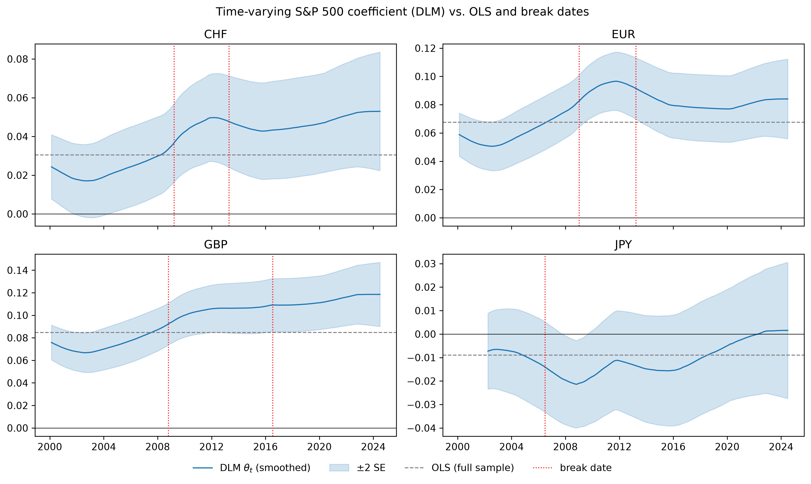

# safe-haven-dlm

**Do safe-haven relationships shift in a few discrete jumps, or drift continuously?**

This project grew out of my bachelor thesis, *The Impact of Major Crises on Safe Haven
Currencies*, written at the Chair of Economics II (Prof. Dr. Hartmut Egger, Dr. Leandro
Navarro) at the University of Bayreuth. The thesis received a Special Prize of the
Deutsche Bundesbank in 2026. Here I take its question further: the analysis is rebuilt
from scratch on free data and extended with a state-space model.

Julius Lustfeld, MSc Economic and Social Sciences, Bocconi University.



*How each currency's excess return against the dollar co-moves with the S&P 500, day by
day, from a dynamic linear model. Dashed: the constant OLS coefficient. Dotted: the
estimated break dates.*

## In short

- **Against the dollar, the franc, the euro and the pound move with US equities, not
  against them.** The full-sample S&P 500 coefficients are 0.030, 0.068 and 0.085. This is
  a post-2008 pattern: before the first break all three are close to zero, in the period
  right after it they are 0.164, 0.192 and 0.126. The yen is the exception, with a
  coefficient of -0.009 that is not distinguishable from zero.
- **The crisis breaks are sharp, the later ones are not.** The first breaks of CHF, EUR and
  GBP fall between October 2008 and March 2009 and are dated to within a few weeks. The
  GBP's 2016 break and the JPY's 2006 break have confidence intervals of several years.
- **The continuous view puts the largest movement between the breaks.** With the
  smoothness parameter used here, the coefficient vector moves clearly away from its
  constant value only for the euro, peaking in July 2011. How many currencies cross that
  line depends on the smoothness parameter, and I show how.
- **One caveat changes magnitudes.** The free exchange-rate data are noon rates, the
  regressors are end-of-day. Adding one lag roughly doubles the equity response.

Full write-up with tables, figures and my reading of them: [`RESULTS.md`](RESULTS.md).

## Question

The thesis located structural breaks in the safe-haven regressions, which assumes that the
coefficients jump at a few dates and are constant in between. Here I rebuild that analysis
on free data and add a state-space model in which the coefficients drift continuously. Neither view settles the question on its own.
Side by side they show when the relationships move and how much.

This is an in-sample structural analysis, not a forecasting exercise. That is a deliberate
choice, stated here so it is not mistaken for an omission.

## Specification

The regression follows Ranaldo and Söderlind (2010), who work with intraday data and
futures returns. Here everything is daily: the excess return of CHF, EUR, GBP and JPY
against the USD is regressed on the S&P 500 return, the change in the 10-year US Treasury
yield, an FX-volatility measure, the TED spread and the change in the VIX.

Exchange rates are quoted as USD per unit of foreign currency, so a positive return is an
appreciation against the dollar. The excess return is the daily log appreciation plus the
daily interest differential.

## Method

**Break dates.** Global least-squares break dating in the sense of Bai and Perron (1998,
2003), with the number of breaks chosen by BIC and a minimum segment of 15% of the sample.
Confidence intervals come from a residual bootstrap. The estimated dates are CHF 2009-03
and 2013-04, EUR 2009-01 and 2013-03, GBP 2008-10 and 2016-07, JPY 2006-06.

**Dynamic linear model (DLM).** The regression coefficients follow a random walk and are
estimated with a Kalman filter and smoother. The observation variance is constant. The
variance of the coefficient innovations is set by one parameter, lambda, which I fix at
1e-3 instead of estimating it. That value is a tight prior: over the whole sample it lets
a coefficient wander by about 2.4 OLS standard errors.

The data would choose more. The likelihood peaks at a lambda between 0.1 and 0.3 for all
four currencies. I do not follow it, because with a constant observation variance the
coefficients are the only place where the model can put volatility clustering, and that
inflates the estimated drift. So the results are conditional on a conservative lambda, and
notebook 05 shows what changes under other values.

## Data

Daily levels from 2000 to mid-2024, the sample of the thesis, all from free sources: FRED
for exchange rates, yields and interbank rates, Yahoo Finance for the S&P 500. The raw
levels are committed in `data/levels.csv`, so the whole pipeline runs from scratch.
Column-by-column sources are in `data/README.md`.

## Limitations

- **Timing.** FRED exchange rates are noon rates in New York; equities, yields and the VIX
  are closing values. The same-day coefficients therefore understate the daily response.
  Notebook 02 quantifies this with lagged regressors. The break and DLM analysis keeps the
  specification without lags.
- **Lambda is fixed, and it matters.** At 1e-3 only the euro crosses the 95% line of the
  joint deviation, at 1e-2 all four currencies do, at 1e-4 none.
- **Constant observation variance.** The innovations show strong volatility clustering and
  fat tails. Stochastic volatility is the natural next step; see `ROADMAP.md`.
- **Drift only.** The random-walk state cannot produce a jump. A one-off event like the
  SNB dropping its euro floor in January 2015 shows up as a single-day outlier.
- **Break dating, not testing.** The number of breaks comes from the BIC. No sequential
  supF tests are run.
- **In-sample only.** No out-of-sample or predictive claim.

## Repository structure

- `notebooks/`: 01 data, 02 baseline OLS and timing check, 03 break dates, 04 DLM (core),
  05 diagnostics and the choice of lambda, 06 state revisions, 07 daily-TED robustness
- `notebooks/safe_haven.py`: the shared construction the notebooks import (excess
  returns and regressors, the DLM, the break search), so the definitions cannot drift
  apart between notebooks
- `data/`: `levels.csv` (committed raw levels) and derived outputs
- `figures/`: generated figures (300 dpi)
- `ROADMAP.md`: parked and planned work

The notebooks also write LaTeX tables to a local `paper/` folder, which is not tracked.

## Reproduction

```
conda create -n dlm python=3.11
conda activate dlm
pip install -r requirements.txt
# run the notebooks in order, starting at 02 - the committed data/levels.csv
# covers the full sample, so no API key is needed
# notebook 01 only re-downloads the raw data and requires a FRED API key in
# .env (FRED_API_KEY=...); 07 uses the key too if present, else the committed
# data/ted_daily.csv
```

Notebooks 02 to 07 run in about three minutes in total.

## References

Bai, J. and Perron, P. (1998). Estimating and Testing Linear Models with Multiple
Structural Changes. *Econometrica*, 66(1), 47-78.

Bai, J. and Perron, P. (2003). Computation and Analysis of Multiple Structural Change
Models. *Journal of Applied Econometrics*, 18(1), 1-22.

Ranaldo, A. and Söderlind, P. (2010). Safe Haven Currencies. *Review of Finance*,
14(3), 385-407. https://doi.org/10.1093/rof/rfq007

Further references, for the interpretation of the results, are in `RESULTS.md`.
