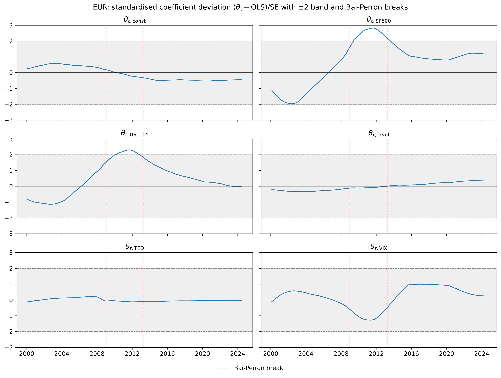
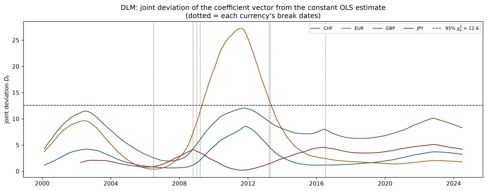
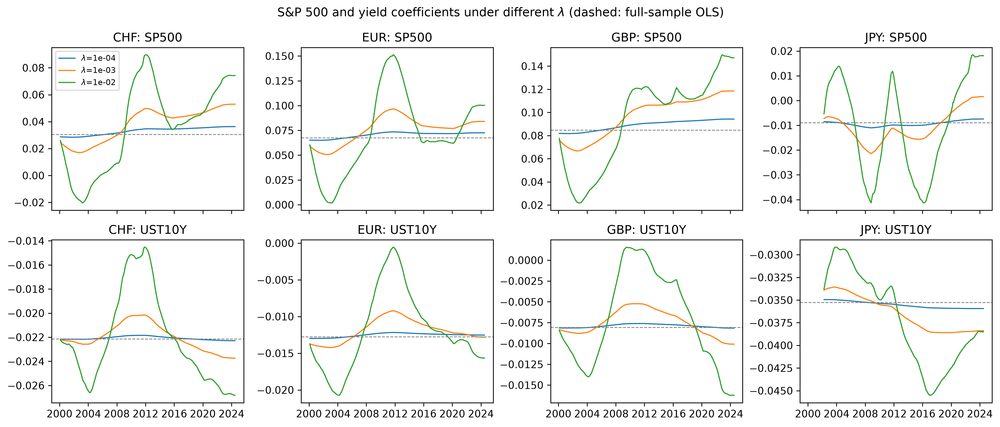
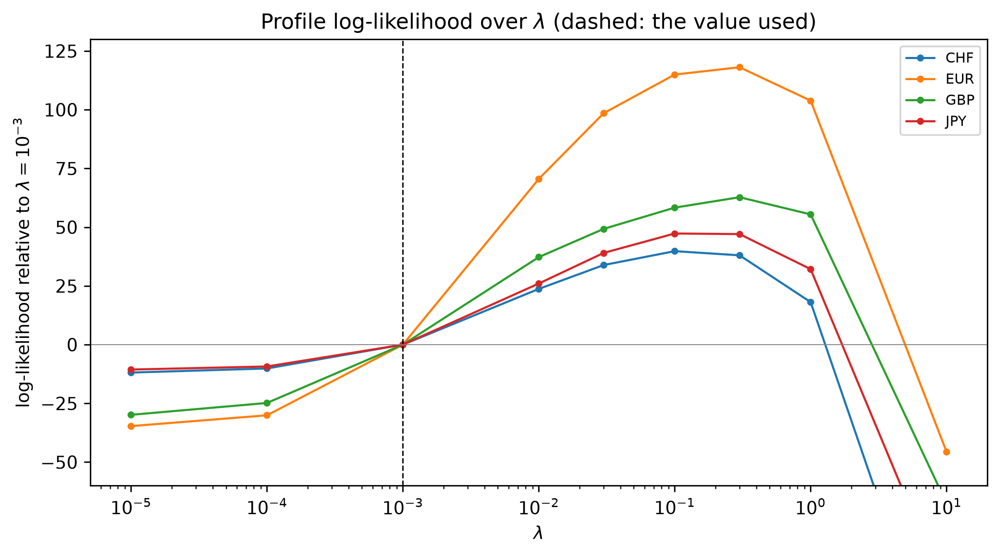

# Results

A plain walk-through of the results, with my reading after each part. The full sample is
2000 to 2024 at daily frequency; OLS uses Newey-West (HAC) standard errors, lag 2.
Significance: \* p<0.1, \*\* p<0.05, \*\*\* p<0.01.

## 1. Static baseline (Table 1)

| | CHF | EUR | GBP | JPY |
|---|---|---|---|---|
| S&P 500 | 0.030** | 0.068*** | 0.085*** | −0.009 |
| | (0.012) | (0.012) | (0.016) | (0.014) |
| UST10Y (Δ yield) | −0.022*** | −0.013*** | −0.008*** | −0.035*** |
| | (0.002) | (0.002) | (0.002) | (0.002) |
| fx volatility (×100) | 0.032 | 0.018 | 0.017 | 0.050* |
| | (0.030) | (0.029) | (0.028) | (0.027) |
| TED | −0.066 | −0.084 | −0.215* | 0.119 |
| | (0.105) | (0.112) | (0.127) | (0.127) |
| VIX | 0.004** | 0.002 | 0.000 | 0.009*** |
| | (0.002) | (0.002) | (0.002) | (0.002) |
| R² | 0.040 | 0.023 | 0.029 | 0.141 |
| N | 5,790 | 5,790 | 5,790 | 5,286 |

Standard errors in parentheses. Three notes on units. Returns are in decimals. The yield
enters as a daily change in percentage points, so −0.022 means that a rise of one
percentage point goes with a 2.2% lower excess return. And every regressor is a daily
change except two: fx volatility is a centred log level, and the TED spread is a level in
percentage points, divided by 360. Their coefficients are not on the same scale as the
others and I do not read them side by side.

The S&P 500 coefficient is significantly positive for CHF, EUR and GBP. For the JPY it is
small, negative and insignificant. The coefficient on the 10-year Treasury yield is
negative for all four currencies and significant throughout. The VIX matters only for the
CHF and the JPY. The fit is very low for CHF, EUR and GBP. The JPY is the exception at
0.141, and most of that hangs on the yield: on its own it gives an R² of 0.128, and
dropping it from the full model costs 0.098. With longer Newey-West bandwidths (9 and 30
lags) the t-statistics shrink a little and no conclusion changes.

**My reading.** The positive S&P 500 sign is the opposite of Ranaldo and Söderlind (2010),
and not what you would expect from pure safe havens: a safe haven should rise when
equities fall. As Section 3 shows, the positive sign comes from the period after the
financial crisis. The likely reason is the dollar itself. In stress it is the currency
everyone runs to, so it strengthens even against CHF, EUR and GBP, which pushes their
excess returns down when the S&P falls. The negative yield coefficient (a positive one on
the bond price) is the interest-rate and carry side of the same story.

There is a cleaner way to state this. Safe-haven behaviour is always measured against a
numeraire, and here that numeraire is the dollar, which is itself the strongest safe haven.
So a positive S&P 500 coefficient does not say the franc, euro and pound are not safe
havens; it says they are weaker havens than the dollar. Grisse and Nitschka (2015) find
exactly this pattern for the franc: when global risk rises, the CHF appreciates against the
euro and against typical carry-trade currencies, but depreciates against the dollar and the
yen. Jiang, Krishnamurthy and Lustig (2021) supply the dollar side of the mechanism: foreign
demand for US safe assets, a convenience yield, lifts the dollar in stress, so even genuine
havens lose ground against it. Read this way, the sign that looks wrong is not a puzzle but a
statement about the benchmark.

One caveat on all of this. Outside the yen the R² is small, so the safe-haven signal is a
minor part of daily FX variation. I read the coefficients as conditional hedging
relationships, a currency's co-movement with global risk in the sense of Habib and Stracca
(2012), not as anything that predicts returns.

### Timing: the same-day coefficients are too small

The FRED exchange rates are noon rates in New York. The S&P 500, the yield and the VIX are
closing values. A noon-to-noon FX return overlaps with yesterday afternoon in the equity
and bond markets as much as with this morning, so part of the response should load on
yesterday's regressors. It does.

| S&P 500 | CHF | EUR | GBP | JPY |
|---|---|---|---|---|
| same day | 0.034 | 0.074 | 0.092 | −0.009 |
| lag 1 | 0.055 | 0.083 | 0.092 | 0.029 |
| t (lag 1) | 3.9 | 6.0 | 5.9 | 1.9 |
| sum | 0.089 | 0.157 | 0.184 | 0.020 |
| R², baseline → with lags | 0.040 → 0.051 | 0.023 → 0.041 | 0.029 → 0.053 | 0.141 → 0.166 |

For CHF, EUR and GBP the lagged coefficient is as large as the same-day one. The lagged
yield change is significant for all four as well (the summed yield coefficients are
−0.032, −0.021, −0.015 and −0.052). Table 1 therefore understates the daily equity
response by roughly half. The signs and the ranking of the currencies stay as they are,
and the positive equity sign of CHF, EUR and GBP gets stronger, not weaker.

Ranaldo and Söderlind avoid the problem by using intraday data. I keep the specification
without lags for the break and DLM analysis below, so that those results stay comparable
with the baseline table, and note it as a limitation.

## 2. Structural breaks

| Currency | Break date | 95% CI |
|---|---|---|
| CHF | 2009-03-24 | 2009-02 to 2009-04 |
| | 2013-04-18 | 2012-07 to 2014-05 |
| EUR | 2009-01-07 | 2008-12 to 2009-02 |
| | 2013-03-28 | 2012-09 to 2013-08 |
| GBP | 2008-10-20 | 2008-10 to 2008-10 |
| | 2016-07-14 | 2015-05 to 2018-11 |
| JPY | 2006-06-29 | 2004-12 to 2007-07 |

The dates are global least-squares estimates in the sense of Bai and Perron (1998, 2003),
with the number of breaks chosen by BIC. This dates the breaks; it does not test for
them. The 95% intervals come from a residual bootstrap (B = 200): I re-estimate the break
date on each resampled series within the two adjacent segments. Since I resample the
residuals independently, the bootstrap ignores the volatility clustering that daily
returns clearly show, so if anything these intervals are a little too narrow.

A narrow interval suggests an abrupt change, a wide one a gradual shift or a weakly
identified date. By that measure the picture splits in two.

The first breaks of CHF, EUR and GBP all sit in the 2008 to 2009 financial crisis and are
pinned down to a few weeks. These are the solid ones.

The later breaks are softer. The second breaks of EUR and CHF fall in the euro crisis
period, with intervals of about a year and two years. The GBP's second break has its point
estimate three weeks after the Brexit referendum of 23 June 2016, which is suggestive, but
its interval runs from 2015 to 2018, and the break is not selected at all when the sample
ends in January 2022 (notebook 07). I would not build an argument on it. The JPY's single
break, in mid-2006, does not match a crisis either. It falls in a turn of the rate cycle
(the Fed reached 5.25% in June 2006, the Bank of Japan ended its zero-rate policy in July),
but with an interval from late 2004 to mid-2007 the date cannot be tied to any single
decision.

Two further points on reading these dates.

The yen fits a carry-trade reading. It has long been the classic funding currency: low
rates, borrowed to buy higher-yielding currencies. Brunnermeier, Nagel and Pedersen (2009)
show that carry trades unwind abruptly when funding liquidity and risk appetite dry up.
A break somewhere in the mid-2000s, during the build-up of the carry trade and before its
later crashes, is consistent with that. It is a reading, not a result.

The franc and the euro are not two independent witnesses. From September 2011 to January
2015 the Swiss National Bank held a floor of 1.20 francs per euro, so for part of the
sample the franc's dollar rate largely followed the euro's. That their break dates almost
coincide is partly a consequence of this.

## 3. OLS by structural-break period

Re-running OLS inside each segment: the S&P 500 coefficient is close to zero before the
first break for CHF, EUR and GBP (−0.015, 0.014 and 0.008, none significant) and
significantly positive after it (0.164, 0.192 and 0.126 in the second period). This is the
risk, or flight-to-dollar, channel. In the middle period the negative yield coefficient
weakens or turns positive, so the interest-rate channel matters less there. The EUR's R²
peaks at 0.163 in 2009 to 2013. The S&P 500 on its own reaches 0.158 in that period, which
shows how much the risk channel drove the euro right after the crisis; because it overlaps
with the VIX, its unique contribution is smaller, at 0.048.

## 4. Time-varying coefficients (DLM)

The dynamic linear model lets each coefficient drift day by day. Here each coefficient is
shown as its distance from the constant OLS value in standard-error units (the grey ±2 band
is the "no real change" zone; break dates are dotted). The constant, fx-volatility and TED
coefficients barely move. The action is in the S&P 500, the yield and the VIX. The
coefficients leave the ±2 band only for the EUR (S&P 500 and yield) and the GBP (S&P 500).
A joint measure over the whole coefficient vector says the same: only the EUR crosses the
95% line, peaking in July 2011, right between its two break dates.

Each line is the Mahalanobis distance of a currency's whole coefficient vector from its
constant OLS value, plotted against the 95% chi-squared line for six coefficients (threshold
12.59); break dates are dotted. The EUR peaks at 27.2, the GBP at 12.0, just below the
line, the CHF at 8.6 and the JPY at 5.1.

**My reading.** Since the random walk assumes smooth drift, the model shows no sharp jumps,
but that is built into the model, not proof that there are none: a real jump would come out
as a smooth ramp. What I can say is that the biggest moves sit between the structural
breaks, where the coefficients are furthest from their constant value.

The time variation itself is not new. Grisse and Nitschka (2015) already document that the
link between the franc and risk factors is significant and becomes stronger in stress. What I
add is the shape of that variation over the whole sample: a continuous-drift path next to the
thesis's discrete breaks, so the two views can be read side by side.

Why the four currencies differ is itself informative. Habib and Stracca (2012) tie safe-haven
status to a country's net foreign asset position and external vulnerability. That the euro
shows the largest movement, and does so around 2011, fits the euro area's specific fragility
in the sovereign-debt crisis (the ECB's "whatever it takes" came in July 2012) rather than a
symmetric story across all four.

One more caveat: I start the filter from the full-sample OLS estimate and its OLS
covariance, so the early part of each path is pulled toward that full-sample value and the
data is effectively used twice. I therefore read the ±2 band and the chi-squared line as
descriptive gauges of how much the coefficients move, not as tests.

## 5. How much of this is lambda?

A good deal. Lambda sets how far the coefficients may travel, and I fixed it at 1e-3. Two
checks from notebook 05 show what that choice does.

**The headline count depends on it.** Maximum of the joint deviation, against the line at
12.59:

| lambda | CHF | EUR | GBP | JPY |
|---|---|---|---|---|
| 1e-4 | 0.9 | 2.6 | 2.9 | 0.4 |
| 1e-3 (used) | 8.6 | 27.2 | 12.0 | 5.1 |
| 1e-2 | 36.0 | 91.5 | 37.5 | 18.1 |

So "only the euro crosses the line" is a statement about lambda = 1e-3. With ten times
more freedom all four currencies cross it, with ten times less none does. Two things are
more stable. At 1e-3 and at 1e-2 the euro moves most, by a wide margin. And for CHF and EUR
the peak falls in the second half of 2011 under all three values. For GBP and JPY the peak
date moves around, so I would not date their largest deviation.

**The likelihood would choose a larger lambda.** With the observation variance
re-estimated at each value, the log-likelihood peaks at a lambda between 0.1 and 0.3 for
all four currencies. Relative to 1e-3 the gain is about 40 log points for the CHF, 47 for
the JPY, 63 for the GBP and 118 for the EUR.

I keep 1e-3 for one reason. The observation variance is constant, and the innovations show
strong volatility clustering (Section 6). In such a model the coefficients are the only
place where changing volatility can go, and leaving out stochastic volatility is a known
way to overstate coefficient drift: Sims (2001) made this point against Cogley and Sargent,
whose 2005 paper added stochastic volatility in response. An estimate of lambda from this
model could well be too large. The fixed value is a deliberately tight prior that shows the
slow movements and little else. A proper answer needs lambda and a time-varying variance
estimated together, which is the first item in `ROADMAP.md`.

## 6. Diagnostics and robustness

**Innovations.** The standardised one-step-ahead errors of the DLM are far from normal for
all four currencies, and their squares are strongly autocorrelated (Ljung-Box, 10 lags,
p-values below 1e-26). The errors themselves show some remaining autocorrelation for CHF,
GBP and JPY and none for the EUR. The constant-variance Gaussian observation equation is
the weakest part of the model.

**Daily TED.** The TED spread used above is built from monthly interbank rates, which
averages away the spikes of 2008 and 2020. Notebook 07 repeats the baseline and the break
search with the daily TED spread on the common sample to January 2022. The TED coefficient
hardly changes, the other coefficients move by less than 0.001, and the break dates are
identical under both series.

**Sample end.** In that shorter sample the GBP's 2016 break is not selected, under either
TED series. All other break dates are unchanged.

**Filtered against smoothed.** Notebook 06 compares the real-time (filtered) and
full-sample (smoothed) coefficient paths. I report it for completeness and do not lean on
it for any conclusion here.

## Wrap-up

The full-sample regression, the breaks and the period regressions say the same thing: the
safe-haven relationships change over time, and the risk and interest-rate channels behave
differently under stress. The crisis breaks of 2008 to 2009 are sharply dated. The later
ones are not, and I read the events near them as plausible triggers, not as causes. The DLM
adds a continuous-drift view next to the discrete breaks: the largest and most robust
movement is the euro's around 2011. How far the other currencies move depends on a
smoothness parameter that this model cannot pin down credibly. Because the model assumes
smooth drift, it also cannot settle gradual against jump on its own. Both open points need
a richer model, with stochastic volatility first and jumps second (see `ROADMAP.md`).

## References

Bai, J. & Perron, P. (1998). Estimating and Testing Linear Models with Multiple Structural
Changes. *Econometrica*, 66(1), 47-78.

Bai, J. & Perron, P. (2003). Computation and Analysis of Multiple Structural Change Models.
*Journal of Applied Econometrics*, 18(1), 1-22.

Brunnermeier, M. K., Nagel, S. & Pedersen, L. H. (2009). Carry Trades and Currency Crashes.
*NBER Macroeconomics Annual 2008*, 23, 313-347.

Cogley, T. & Sargent, T. J. (2005). Drifts and Volatilities: Monetary Policies and Outcomes
in the Post WWII US. *Review of Economic Dynamics*, 8(2), 262-302.

Grisse, C. & Nitschka, T. (2015). On financial risk and the safe haven characteristics of
Swiss franc exchange rates. *Journal of Empirical Finance*, 32, 153-164.

Habib, M. M. & Stracca, L. (2012). Getting beyond carry trade: What makes a safe haven
currency? *Journal of International Economics*, 87(1), 50-64.

Jiang, Z., Krishnamurthy, A. & Lustig, H. (2021). Foreign Safe Asset Demand and the Dollar
Exchange Rate. *Journal of Finance*, 76(3), 1049-1089.

Ranaldo, A. & Söderlind, P. (2010). Safe Haven Currencies. *Review of Finance*, 14(3),
385-407. https://doi.org/10.1093/rof/rfq007

Sims, C. A. (2001). Comment on Sargent and Cogley's "Evolving Post-World War II U.S.
Inflation Dynamics". *NBER Macroeconomics Annual 2001*, 16, 373-379.
